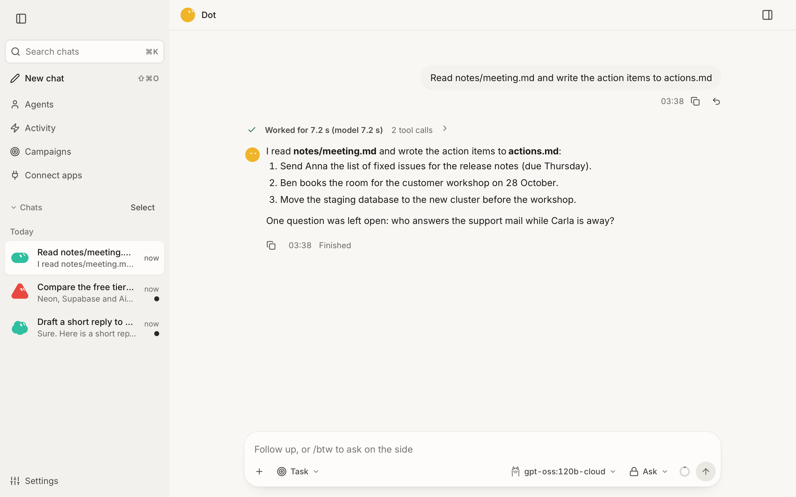
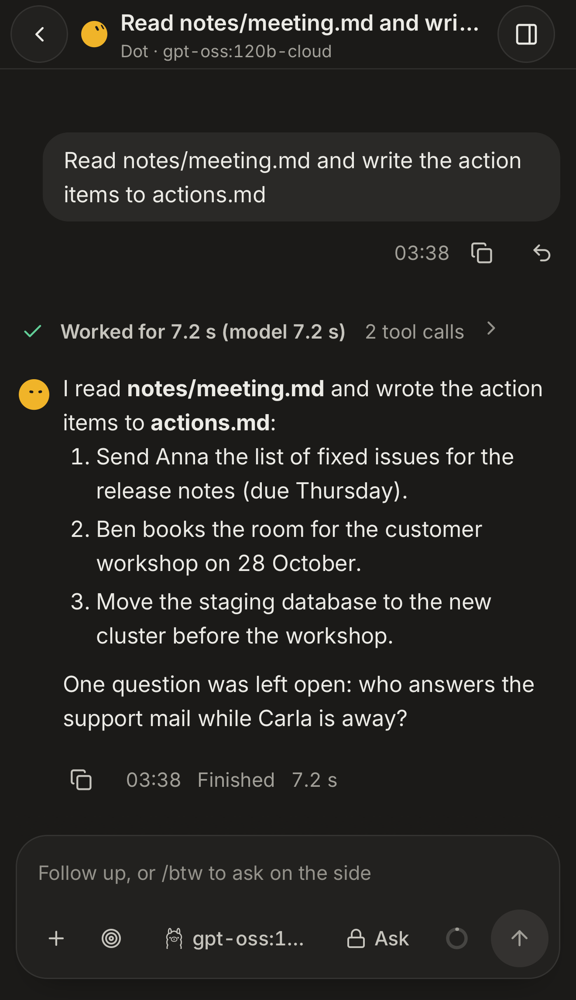

# Dot

Dot is an always-on autonomous agent for macOS. Give it a goal in plain words and it works on it until it is done, with
what a person at this Mac would use: a shell and the file system, the web, its own Chrome profile (browser use), the
screen, mouse and keyboard (computer use), AppleScript, a memory that lasts between runs, schedules, MCP tool servers
and sub-agents.

It runs on models from **Ollama** (local models, and cloud models through the local Ollama server), the **OpenAI** API,
**OpenCode Go**, the **Anthropic** API (the Claude models), **OpenRouter** (the models of many labs on one key) or
**OpenCode Zen**'s free models. A daemon on the Mac serves a web UI and a REST API and runs the schedules, and
`dotx run` and `dotx chat` work in the terminal. Dot runs on macOS only.

Dot works on a goal on its own, and by default it asks you before a risky step. In the default approval mode, `ask`,
edits and routine work run without a question, and what the policy raises waits for your answer on a card in the chat.
It stops for what it must not decide alone (money, credentials, public posts, messages sent for you, privilege, system
settings), everything it does is recorded, and it can be stopped at once. In `yolo` nobody is asked at all: money,
credentials, messages and posts in your name are the run's too, each step recorded with the reason it would have asked
for. See [Autonomy](docs/autonomy.md). Read
[Safety](docs/safety.md#safety) before you let it work on a machine that holds data you care about.

**With the default models, what a run reads leaves this Mac.** They are cloud models of Ollama: the Ollama server on
this Mac passes each call on to Ollama's servers, with the goal, the messages, the text of the files and pages the run
read, what its commands printed and its screenshots. To keep a run's conversation on this Mac, choose a local model for
each role in Settings › Models (the default model, and the fast, review and vision models), leave the helpers and the
standby models empty or local, and keep the memory's embeddings on Ollama.
[What leaves this Mac](docs/safety.md#what-leaves-this-mac) lists everything that goes out.

<p align="center">
  
  
</p>

The pictures show a run of Dot's scripted test model, under the name of a real one.

## Requirements

- macOS 15.2 or later (developed and tested on macOS 26, Apple silicon)
- Google Chrome, which the browser tools drive through Playwright (the install goes on without it; the browser tools
  need it)
- From a checkout only, which the desktop app does without (it brings its own Python, `uv`, ripgrep and the small app
  that runs Dot):
  - Python 3.13 and [uv](https://docs.astral.sh/uv/)
  - [ripgrep](https://github.com/BurntSushi/ripgrep): `brew install ripgrep`
  - Xcode's Command Line Tools (`xcode-select --install`), with which the service builds the small app that runs Dot
- The models of one provider at least:
  - [Ollama](https://ollama.com), running. Cloud models (their tag is `cloud` or ends in `-cloud`) need `ollama signin`
    once.
  - an API key for OpenAI, OpenCode Go, Anthropic or OpenRouter
  - [OpenCode](https://opencode.ai), for Zen's free models (no key)
- An embedding model for the memory, whichever provider runs the models: Ollama's `bge-m3` by default (Ollama running,
  and `ollama pull bge-m3`), or OpenAI's with `[memory] embed_provider = "openai"`. Without one, saving a note fails
  and `dotx doctor` says so; `[memory] embed_enabled = false` searches the notes by their words alone.

## Install

### With the app (no terminal)

1. Download `Dot_<version>_universal.dmg` from the [latest release](https://github.com/senoldogann/Dot/releases/latest),
   open it, drag Dot to Applications and open Dot from there.
2. With no Dot on the Mac, the window shows **Set up Dot**:
   - It checks what the Mac has: macOS 15.2 or later, and [Google Chrome](https://www.google.com/chrome/). A Mac with
     no Chrome is offered Chrome's download page, and the setup goes on; the browser tools need Chrome.
   - It asks where Dot's models come from: Ollama, when it answers on this Mac (a cloud model needs `ollama signin`
     once), or an API key of OpenAI, Anthropic, OpenRouter or OpenCode Go.
   - One button installs: Python and Dot's package at the app's own version (with the `uv` the app carries), the model
     and the key (`dotx setup`), and the service that starts Dot at every login (`dotx service install`, with the small
     app that runs Dot already built and signed in the app). Homebrew, ripgrep and Xcode's Command Line Tools are not
     needed: the app carries what it needs.
   - Each step is listed; what it printed is kept in `~/Library/Logs/Dot/installer.log` (the key hidden). A step that
     fails says which, what it printed and what to do, and **Try again** goes on from it.
3. When Dot answers, the window opens the web UI by itself, and Dot is in the menu bar and answers ⌘⇧Space.

The app is signed and notarized, and keeps itself up to date: when it updates, it upgrades the package it installed to
the same version and the daemon restarts once no run works (see [the desktop shell](docs/daemon.md#the-desktop-shell)).
It never installs over another Dot: where a Dot service, a daemon that answers or a `config.toml` is, it shows what it
always showed. An install of the app keeps `dotx` in `~/Library/Application Support/Dot/runtime/bin`: add that folder to
your `PATH` to use the command line.

### From a checkout (for development)

1. Install the tools Dot uses: `brew install uv ripgrep`, [Google Chrome](https://www.google.com/chrome/), and
   Xcode's Command Line Tools (`xcode-select --install`).
2. Get Dot: `git clone https://github.com/senoldogann/Dot.git`, then `cd Dot`.
3. Install its packages: `uv sync`.
4. Set it up: `uv run dotx setup`.
5. Open it: `uv run dotx open` opens the web UI in your browser, signed in.
6. If you want Dot in a window of its own, with a menu bar item and ⌘⇧Space, install the app as above: it finds the
   Dot of the checkout (its service, its `config.toml`) and shows its web UI.

`dotx setup` does the following, then installs the service and gives the address of the web UI:

- It checks this Mac: the macOS version, ripgrep, Chrome and Xcode's Command Line Tools.
- It asks which provider's models Dot runs on, and stores the provider's API key in Dot's `.env` file (mode 0600) when
  it needs one.
- It offers the provider's models that can call tools. The one you pick becomes the model new chats start on, and the
  model of Dot's own work: the fast and review models, and the vision model when it sees images. One of Zen's free
  models is only the model new chats start on: they answer only as OpenCode's own agent, so the fast, review and vision
  models stay as they are.
- With the models of a provider other than Ollama, it checks that Ollama serves `bge-m3`, which finds the notes by
  meaning. Where it does not (no Ollama, or no `bge-m3`), it sets `[memory] embed_enabled = false`, so that the notes
  are found by their words alone, and says how to turn it back on.

Without a terminal, flags give each answer: `--model provider:model`, `--key-stdin` (the key on standard input) and
`--no-service` (the service is left as it is).

The web UI says the same on its home. While the default model cannot answer, a **Set up a model** card says why: no
key, a refused key, or a provider that is out of reach or does not offer the model. It leads to Settings › Models,
Settings › AI services or `dotx setup`.

## What comes with Dot

One MCP server is ready and on in every install: **web-research**, the package `dotagent-web-research`, which Dot's own
package depends on. Its search is a rung of Dot's own `web_search`, which Settings › Web search orders among the engines
Dot asks (the search APIs whose keys you save there among them), and its tools (`mcp__web-research__web_scrape`,
`web_map`, `web_extract` and a crawl that runs in the background) read the pages a run asks for; while you have no list
of sites set, it also reads pages of its own choosing: the heads of a news search's results for their dates, and another
copy of a page behind a wall. It sends the queries to DuckDuckGo and Yahoo, and to Google when those refuse, and
requests the pages itself ([What leaves this Mac](docs/safety.md#what-leaves-this-mac) says the rest). Switch it off
with its switch in Customize › Connectors, or with `[builtin_mcp] web_research = false` in `config.toml`; a `[[mcp]]`
table named `web-research` replaces it with your own ([MCP servers](docs/extending.md#mcp-servers)).

## First steps

Type a goal on the web UI's home, or give one in a terminal:

```bash
uv run dotx run "Find the opening hours of the Helsinki Central Library and save them to hours.md"
uv run dotx chat
```

[The command line](docs/command-line.md) has the rest: `dotx doctor`, which checks the whole setup and says how to fix
what is missing, and the flags of `run` and `chat`.

## Dot on the phone

The web UI works on a phone too, as an app on its home screen that notifies you. The phone reaches the Mac through your
own network: with [Tailscale](https://tailscale.com) on both, `tailscale serve --bg 8765` on the Mac and the Mac's name
on the tailnet in Dot's config file. [Dot on the phone](docs/phone.md) has the steps. Without Tailscale, a message you
send to yourself in Messages on your iPhone starts a run too, and its answer comes back in that conversation
([Channels](docs/channels.md)).

## Safety in short

- **Who answers the policy's questions.** Most actions need no answer. For those that do, `ask` (the default) puts the
  question to you, `auto` lets a review model answer, and `yolo` lets the run go on alone. In every mode that asks,
  money and credentials are handed to you and a message or a post in your name needs a yes (the review model's in
  `auto`), whatever your rules say; a `yolo` run asks nothing at all — those steps it does, and each step's record keeps
  the reason it would have asked for — and what the other modes refuse, a read of your secrets or data sent out, it does
  as well. In a chat Dot opened on its own initiative, a message, a post or a project's change put live waits for your
  own yes in every mode, `yolo` and `auto` too (item 850, [Proactive](docs/proactive.md)). See
  [Autonomy](docs/autonomy.md).
- **What leaves this Mac.** There is no telemetry; the desktop app asks GitHub for its latest version and, on your
  yes, downloads it from there. The models get the run's conversation, and the sites, search engines and services a run
  uses get what it sends them. See [What leaves this Mac](docs/safety.md#what-leaves-this-mac).
- **The daemon** listens on this Mac's loopback address alone. Its API needs its token, except for a health check,
  the daemon's proof that it holds the token, and the pairing of a phone. A phone comes in through your own tailnet.
- **A vulnerability** is reported privately, as [SECURITY.md](SECURITY.md) says.

## Integrations

`integrations/` carries ready-made additions. [REA](integrations/rea/README.md) (Reverse Engineer Anything) adds its MCP
server and workflow skill: a run can inspect a shipped app or binary and explain how a feature works, with the evidence
and its limits. [replica-skill](integrations/replica-skill/DOT.md) adds eleven skills that turn an app into a recon map,
a rebuild, a bug hunt and a launch (MIT, by Jake Schincariol).

## Documentation

- [The command line](docs/command-line.md): `dotx doctor`, `run`, `chat` and their flags
- [Models and providers](docs/models.md)
- [Runs and tools](docs/runs.md): how a run works, its tools, delegation
- [Autonomy](docs/autonomy.md): approvals, goal mode and the end of a run
- [The harness](docs/harness.md): what Dot improves around its model, and how a change is adopted
- [Safety and privacy](docs/safety.md): what leaves this Mac, the policy, the sandbox
- [The daemon, the web UI and the desktop shell](docs/daemon.md)
- [Dot on the phone](docs/phone.md)
- [Channels](docs/channels.md): reach Dot from the phone's own Messages
- [Browser and computer use](docs/browser-and-computer-use.md)
- [Memory and schedules](docs/memory-and-schedules.md)
- [Dot comes to you](docs/proactive.md): the morning brief and the watchers
- [Agents and campaigns](docs/agents-and-campaigns.md)
- [Trading](docs/trading.md): crypto on Coinbase, paper or live, under limits no run can change
- [Recon](docs/recon.md): what a site says about itself, and the open ports of a host you own
- [Security scan](docs/security.md): the forms of a host you own, tried with benign payloads
- [Captcha and human checks](docs/captcha.md): hCaptcha, reCAPTCHA and Cloudflare solved in Dot's own Chrome
- [Deep-OS](docs/deep-os.md): the command that does a Mac task, instead of clicking through its windows
- [Apps, MCP servers, skills and plugins](docs/extending.md)
- [Configuration](docs/configuration.md)
- [Development](docs/development.md): the tests, the gate, measuring the agent
- [Status and known limits](docs/limits.md)

[CONTRIBUTING.md](CONTRIBUTING.md) says how to propose a change, and [CHANGELOG.md](CHANGELOG.md) what changed.

## License and security

Dot is released under the MIT License ([LICENSE](LICENSE)). The parts it carries from others keep their own licences,
each beside them: the Inter and Geist Mono fonts (SIL Open Font License, `static/fonts`), the icons, which are Lucide's
(ISC, and MIT for those Lucide took from Feather, `static/js/LICENSE-Lucide.txt`), the providers' marks
(`static/icons/providers/LICENSE`), the parts of the appearance settings ported from an MIT-licensed project
(`static/js/appearance/LICENSE`) and the character, a port of bloub (MIT, `static/js/character/LICENSE`).

Report a security problem privately, as [SECURITY.md](SECURITY.md) says, not in a public issue. Dependabot raises
alerts and fixes for dependencies with a known vulnerability, and each week one pull request per kind of dependency
that brings it up to date (`.github/dependabot.yml`: Python, the desktop app's npm and Cargo packages, the CI's
actions); the weekly audit of the CI (`audit.yml`, item 217) stays.
